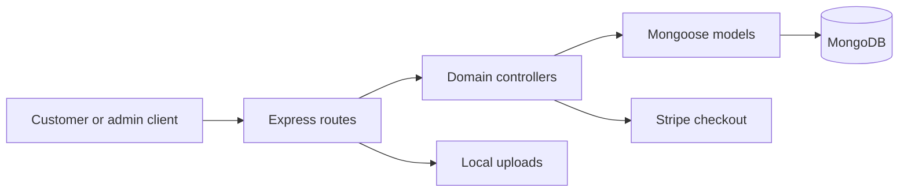

# Food Ordering API

**The backend services behind a menu, shopping cart, and checkout flow.**

This repository contains an Express application for food catalog management, user accounts, cart persistence, and orders. MongoDB stores application records; Stripe is used to create checkout sessions.

## What it provides

- User registration and login with token creation.
- Food catalog routes and local image serving.
- Cart add, remove, and retrieval operations.
- Order placement, customer order history, and status management.
- Stripe checkout-session creation and return-flow handling.

## Run locally

Use Node.js/npm, MongoDB, and your own Stripe test account. Create a local `.env` with:

| Variable | Purpose |
|---|---|
| `MONGODB_URI` | Database connection |
| `JWT_SECRET` | Signing account tokens |
| `STRIPE_SECRET_KEY` | Checkout provider key |
| `FRONTEND_URL` | Customer application's checkout return origin |

```bash
npm install
npm start
```

The server listens on **port 4000**. `GET /` returns the basic API message. Use `npm run server` for the Nodemon development entry point.

## API map

| Prefix | Responsibility |
|---|---|
| `/api/user` | Accounts and authentication |
| `/api/food` | Food catalog |
| `/api/cart` | Shopping cart |
| `/api/order` | Order workflow |
| `/images` | Uploaded image files |

## Architecture



[`server.js`](server.js) composes the application. [`routes/`](routes), [`controllers/`](controllers), and [`models/`](models) separate HTTP routing, workflow logic, and persistence.

## Using the project

Connect a frontend to `http://localhost:4000` and start with the food-list and account routes. Use test-mode payments while exploring checkout. Administrative authorization and payment verification need review before adapting this development project for a live store. A customer or admin UI is not included in this repository.
